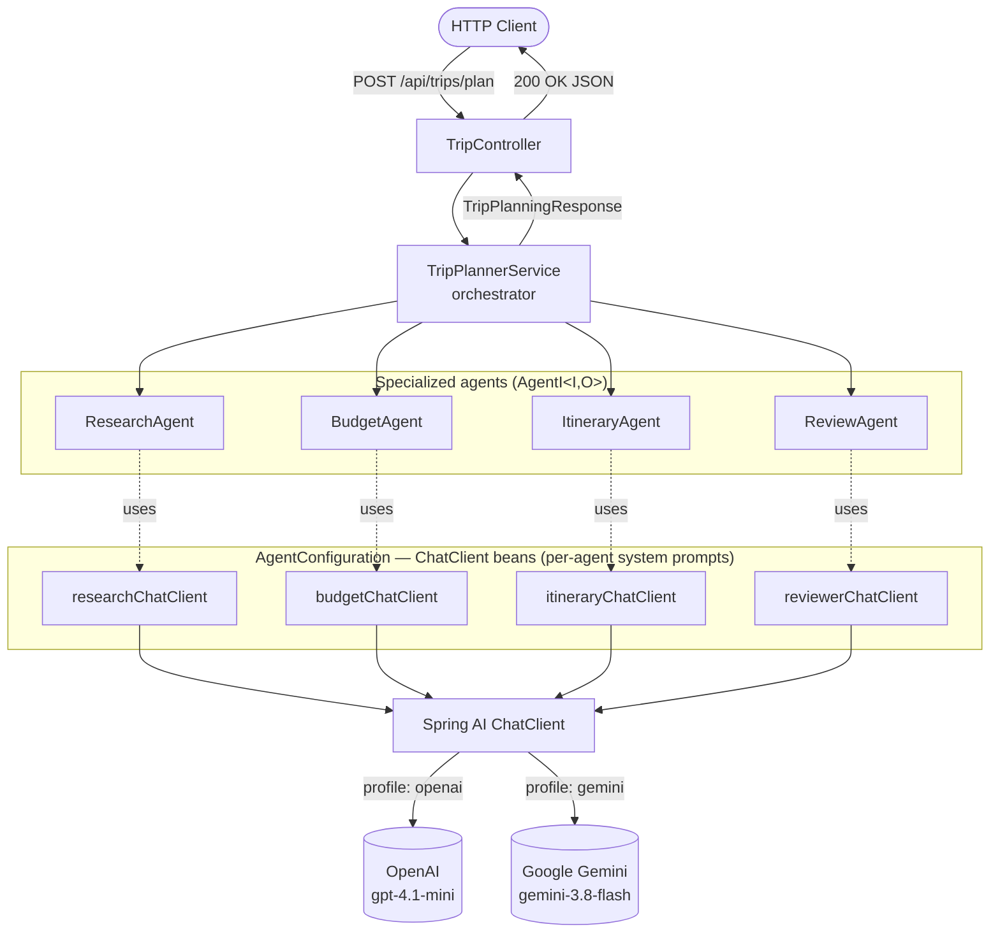
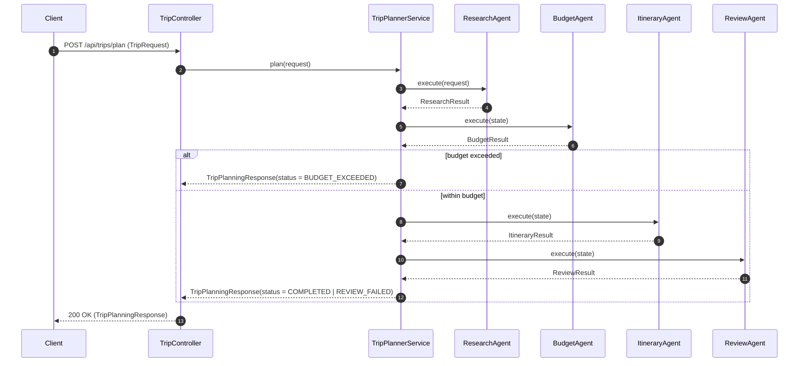

# Spring AI Multi-Agent Trip Planner

A reference implementation of a **multi-agent system** built with [Spring AI](https://docs.spring.io/spring-ai/reference/) and Spring Boot 4. A single HTTP request kicks off a pipeline of four specialized LLM-backed agents that **research**, **budget**, **plan**, and **review** a trip, each with its own role, system prompt, and strongly-typed output.

The project is model-agnostic: it ships with Spring profiles for both **OpenAI** and **Google Gemini**, selectable at startup without touching code.

---

## Table of contents

- [What it does](#what-it-does)
- [Architecture](#architecture)
- [Workflow sequence](#workflow-sequence)
- [Project layout](#project-layout)
- [The agents](#the-agents)
- [Tech stack](#tech-stack)
- [Getting started](#getting-started)
- [API](#api)
- [Configuration & profiles](#configuration--profiles)
- [How it works under the hood](#how-it-works-under-the-hood)

---

## What it does

Given a destination, number of days, budget, and preferences, the system produces a validated, day-by-day trip plan. The work is split across four cooperating agents orchestrated by a central service:

1. **Research** — finds attractions, food options, and travel tips.
2. **Budget** — estimates accommodation/transport/food/activity costs and checks affordability.
3. **Itinerary** — builds a realistic day-by-day plan within budget.
4. **Review** — validates the full plan for consistency and correctness.

A **budget gate** short-circuits the pipeline: if the estimated cost exceeds the requested budget, itinerary planning is skipped and the caller gets a `BUDGET_EXCEEDED` response with concrete cost-cutting recommendations.

---

## Architecture

Each agent is a Spring `@Component` that depends on a dedicated `ChatClient` bean. The `ChatClient` beans are defined once in `AgentConfig`, each carrying its own **system prompt** (the agent's "role") and a `SimpleLoggerAdvisor`. Agents share no mutable state — context flows forward through an immutable `TripState` record.



**Design principles at work:**

- **Single responsibility per agent** — each agent's system prompt forbids it from doing another agent's job (e.g. the research agent is told *not* to do budgeting).
- **Typed structured output** — every agent returns a Java `record` via `.call().entity(SomeResult.class)`; no string parsing.
- **Immutable state passing** — `TripState` is a record with `withX(...)` copy methods; the orchestrator threads it through the pipeline.
- **Pluggable models** — swapping OpenAI for Gemini is a profile change, not a code change.

---

## Workflow sequence



The response `status` is one of:

| Status | Meaning |
| --- | --- |
| `COMPLETED` | Full plan produced and the review agent marked it valid. |
| `REVIEW_FAILED` | Plan produced, but the review agent flagged it invalid (see `review.issues`). |
| `BUDGET_EXCEEDED` | Budget gate tripped; no itinerary generated. |

---

## Project layout

```
src/main/java/com/springai/multiagent/
├── MultiAgentApp.java                 # Spring Boot entry point
├── controller/
│   └── TripController.java            # REST endpoint: POST /api/trips/plan
├── services/
│   └── TripPlannerService.java        # Orchestrator — runs the agent pipeline + budget gate
├── configuration/
│   └── AgentConfiguration.java        # Four ChatClient beans, one per agent, each with its system prompt
├── agents/
│   ├── AgentI.java                    # Generic agent contract: O execute(I input)
│   ├── ResearchAgent.java             # TripRequest  -> ResearchResult
│   ├── BudgetAgent.java               # TripState    -> BudgetResult
│   ├── ItineraryAgent.java            # TripState    -> ItineraryResult
│   └── ReviewAgent.java               # TripState    -> ReviewResult
└── dto/
    ├── TripRequest.java               # Inbound request
    ├── TripState.java                 # Immutable context passed between agents
    ├── ResearchResult.java            # Agent outputs (structured)
    ├── BudgetResult.java
    ├── ItineraryResult.java           # Contains nested DayPlan record
    ├── ReviewResult.java
    └── TripPlanningResponse.java      # Aggregated response returned to the client

src/main/resources/
├── application-openai.properties      # Profile: openai
└── application-gemini.properties      # Profile: gemini
```

---

## The agents

All agents implement a single generic contract:

```java
public interface AgentI<I, O> {
    String name();
    O execute(I input);
}
```

| Agent | Input | Output | Responsibility |
| --- | --- | --- | --- |
| `ResearchAgent` | `TripRequest` | `ResearchResult` | Attractions, food options, travel tips. |
| `BudgetAgent` | `TripState` | `BudgetResult` | Cost breakdown + `withinBudget` flag + recommendations. |
| `ItineraryAgent` | `TripState` | `ItineraryResult` | Day-by-day plan (`List<DayPlan>`), cost-constrained. |
| `ReviewAgent` | `TripState` | `ReviewResult` | Validates day count, budget, consistency; returns issues. |

Each agent is wired to its own `ChatClient` via `@Qualifier`, so system prompts stay isolated:

```java
public ResearchAgent(@Qualifier("researchChatClient") ChatClient chatClient) { ... }
```

---

## Tech stack

| Layer | Choice |
| --- | --- |
| Language / runtime | Java 17 |
| Framework | Spring Boot 4.1.0 (Spring MVC) |
| AI | Spring AI 2.0.0 (`ChatClient`, structured output, advisors) |
| Models | OpenAI `gpt-4.1-mini` *or* Google Gemini `gemini-3.8-flash` |
| Build | Maven |

---

## Getting started

### Prerequisites

- JDK 17+
- Maven 3.9+
- An API key for your chosen model provider

### Set your API key

Depending on the profile you run:

```bash
# For the OpenAI profile
export OPENAI_API_KEY=sk-...

# For the Gemini profile
export GEMINI_API_KEY=...
```

> On Windows PowerShell: `$env:OPENAI_API_KEY = "sk-..."`

### Run

```bash
# OpenAI (default dependency in pom.xml)
mvn spring-boot:run -Dspring-boot.run.profiles=openai

# Gemini
mvn spring-boot:run -Dspring-boot.run.profiles=gemini
```

> **Note on dependencies:** `pom.xml` currently activates the `spring-ai-starter-model-openai` starter. To run the **gemini** profile, uncomment the `spring-ai-starter-model-google-genai` dependency in `pom.xml`. If *both* starters are on the classpath at once, the profile files disable the model autoconfigurations that don't apply (see [Configuration & profiles](#configuration--profiles)) so the context starts cleanly with only one provider's key present.

---

## API

### `POST /api/trips/plan`

**Request body** (`TripRequest`):

```json
{
  "destination": "Kyoto, Japan",
  "numberOfDays": 4,
  "preferences": "temples, local food, walking-friendly, avoid crowds"
}
```

**Example:**

```bash
curl -X POST http://localhost:8080/api/trips/plan \
  -H "Content-Type: application/json" \
  -d '{
        "destination": "Agra and Mathura",
        "numberOfDays": 3,
        "preferences": "temples, local food, walking-friendly"
      }'
```

**Response** (`TripPlanningResponse`): the original `request`, plus `research`, `itinerary`, `review`, and a `status` string.

```json
{
  "request": {
    "destination": "Agra and Mathura",
    "numberOfDays": 3,
    "preferences": "temples, local food, walking-friendly"
  },
  "research": {
    "attractions": [
      "Shri Krishna Janmabhoomi Temple Complex (Mathura)",
      "Dwarkadhish Temple and Vishram Ghat (Mathura)",
      "Banke Bihari Temple (Vrindavan, Mathura district)",
      "Prem Mandir (Vrindavan, Mathura district)",
      "Taj Mahal and Mehtab Bagh (Agra)",
      "Agra Fort (Agra)",
      "Mankameshwar Temple and Rawatpara Heritage Lanes (Agra)"
    ],
    "travelTips": [
      "Taj Mahal is closed for visitors on Fridays; plan the Agra segment accordingly.",
      "The temple alleys in Mathura and Vrindavan are primarily pedestrian; wear comfortable, easy-to-remove walking shoes.",
      "Monkeys are prevalent and aggressive near temples in Mathura and Vrindavan; keep spectacles, sunglasses, bags, and food items tucked away securely.",
      "Modest dress covering knees and shoulders is required when visiting active Hindu temples.",
      "Agra and Mathura are approximately 55 kilometers apart, easily connected by a 1-hour train or cab journey.",
      "Book entry tickets online in advance for Taj Mahal and Agra Fort via the Archaeological Survey of India (ASI) portal to bypass queue times."
    ],
    "foodOptions": [
      "Mathura Peda at Brijwasi Mithai Wala (Mathura)",
      "Kachori, Jalebi, and Makhan Samosa near Vishram Ghat (Mathura)",
      "Bedmi Puri, Aloo Sabzi, and Nagori Halwa at Deviram Sweets (Agra)",
      "Traditional Agra Petha at Panchi Petha (Agra)",
      "Local street food and chaat at Sadar Bazaar (Agra)",
      "Thali and dairy delicacies at Shankar Mithai Wala (Mathura)"
    ]
  },
  "itinerary": {
    "days": [
      {
        "day": 1,
        "morning": "Arrive in Mathura, check into your stay, and explore Shri Krishna Janmabhoomi Temple Complex on foot. Enjoy a breakfast of fresh Kachori, Jalebi, and Makhan Samosa near Vishram Ghat.",
        "afternoon": "Explore Dwarkadhish Temple and walk along the riverfront steps of Vishram Ghat, followed by lunch featuring local thali and dairy delicacies at Shankar Mithai Wala.",
        "evening": "Attend the evening Yamuna Aarti at Vishram Ghat and stroll through the pedestrian bazaars to taste and buy Mathura Peda at Brijwasi Mithai Wala."
      },
      {
        "day": 2,
        "morning": "Take a short battery rickshaw ride to Vrindavan to navigate the pedestrian alleys and seek blessings at Banke Bihari Temple, keeping eyewear safely tucked away.",
        "afternoon": "Visit the architectural Prem Mandir complex, then take a 1-hour pre-booked cab or train transit to Agra (55 km) and check into a Taj Ganj hotel.",
        "evening": "Take a walking tour of the Rawatpara Heritage Lanes, pay respects at the historic Mankameshwar Temple, and sample traditional Agra Petha at Panchi Petha."
      },
      {
        "day": 3,
        "morning": "Start early with a walking tour of the Taj Mahal using advance online tickets, followed by a hearty breakfast of Bedmi Puri, Aloo Sabzi, and Nagori Halwa at Deviram Sweets.",
        "afternoon": "Tour the grand courtyards and palaces of Agra Fort using pre-booked ASI entry tickets for a smooth, self-paced walking exploration.",
        "evening": "Catch sunset views of the Taj Mahal from Mehtab Bagh across the river, concluding the journey with an evening street food and chaat walk at Sadar Bazaar."
      }
    ]
  },
  "review": {
    "valid": true,
    "summary": "A well-paced 3-day itinerary covering Mathura, Vrindavan, and Agra. It fulfills all preferences for temples, walking-friendly heritage routes, and iconic local food while remaining well within the ₹35,000 budget at an estimated total of ₹19,000.",
    "issues": [],
    "recommendations": [
      "Ensure Day 3 does not fall on a Friday, as the Taj Mahal is closed to visitors on Fridays.",
      "Check midday temple closing hours for Prem Mandir and Banke Bihari Temple on Day 2, as sanctums often close between 12:00 PM and 4:30 PM.",
      "Secure spectacles, cameras, and food items in zipped bags while walking through Vrindavan alleys to prevent monkey snatching."
    ]
  },
  "status": "COMPLETED"
}
```

```bash
curl -X POST http://localhost:8080/api/trips/plan \
  -H "Content-Type: application/json" \
  -d '{
        "destination": "Jaipur",
        "numberOfDays": 3,
        "preferences": "temples, local food, walking-friendly"
      }'
```

**Response** (`TripPlanningResponse`): the original `request`, plus `research`, `itinerary`, `review`, and a `status` string.

```json
{
  "request": {
    "destination": "Jaipur",
    "numberOfDays": 3,
    "preferences": "temples, local food, walking-friendly"
  },
  "research": {
    "attractions": [
      "Govind Dev Ji Temple (City Palace complex)",
      "Birla Mandir (Laxmi Narayan Temple)",
      "Galtaji Temple (Monkey Temple)",
      "Moti Dungri Ganesh Temple",
      "Jagat Shiromani Temple (Amer)",
      "Hawa Mahal and the Old City Bazaars walking precinct",
      "City Palace and Jantar Mantar complex"
    ],
    "travelTips": [
      "The Old Walled Pink City (Johari Bazaar, Bapu Bazaar) is best explored on foot early morning before market traffic peaks.",
      "Most temples in Jaipur follow strict 'Aarti' schedules and remain closed between 12:00 PM and 4:30 PM.",
      "Dress modestly when visiting temples; ensure shoulders and knees are covered, and be prepared to remove shoes at entrances.",
      "Jaipur Metro provides direct, low-cost connectivity to Badi Chaupar for easy pedestrian access to central sights.",
      "Wear slip-on shoes with good grip for navigating temple complexes and stone paved walking routes like Galtaji."
    ],
    "foodOptions": [
      "Rawat Mishthan Bhandar (Pyaaz Kachori, Mawa Kachori)",
      "Laxmi Mishthan Bhandar / LMB, Johari Bazaar (Ghewar, Rajasthani Thali)",
      "Gulab Ji Chai Wale (Masala Chai, Bun Muska)",
      "Pandit Kulfi (Traditional Kulfi Falooda near Hawa Mahal)",
      "Samrat Restaurant (Poha, Jalebi, Samosa for morning breakfast)",
      "Thali and Dal Baati Churma at traditional local eateries in the Old City"
    ]
  },
  "itinerary": {
    "days": [
      {
        "day": 1,
        "morning": "Start with breakfast at Samrat Restaurant featuring Poha and Jalebi. Walk through the Old Walled Pink City precinct early to beat the crowds and attend the morning Aarti at Govind Dev Ji Temple inside the City Palace complex.",
        "afternoon": "During the midday temple closure between 12:00 PM and 4:30 PM, tour the City Palace and Jantar Mantar complex. Enjoy a traditional Dal Baati Churma and Rajasthani Thali lunch at a local eatery in the Old City.",
        "evening": "Embark on a pedestrian exploration of Johari Bazaar and Bapu Bazaar. Sample Ghewar at Laxmi Mishthan Bhandar (LMB) and conclude the night with traditional Kulfi Falooda at Pandit Kulfi near Hawa Mahal."
      },
      {
        "day": 2,
        "morning": "Enjoy Pyaaz Kachori and Mawa Kachori at Rawat Mishthan Bhandar, then take transit north to explore the historic Jagat Shiromani Temple in Amer on foot, taking note of its intricate carvings before midday.",
        "afternoon": "Take the Jaipur Metro back towards central Jaipur while temples pause operations between 12:00 PM and 4:30 PM. Relax with Masala Chai and Bun Muska at Gulab Ji Chai Wale.",
        "evening": "Wear slip-on walking shoes to navigate the paved stone walking route up to Galtaji Temple (Monkey Temple) in time for the late-afternoon opening and serene sunset Aarti."
      },
      {
        "day": 3,
        "morning": "Visit Moti Dungri Ganesh Temple for early morning prayers, followed by a short walk to the adjacent Birla Mandir (Laxmi Narayan Temple) to admire its white marble architecture.",
        "afternoon": "Take a midday break while temples are closed from 12:00 PM to 4:30 PM; indulge in a hearty Rajasthani thali at LMB in Johari Bazaar and explore nearby pedestrian alleys.",
        "evening": "Head via Jaipur Metro to Badi Chaupar to view Hawa Mahal and the illuminated Old City bazaars on foot, picking up souvenirs and savouring street snacks before departure."
      }
    ]
  },
  "review": {
    "valid": true,
    "summary": "A well-structured 3-day walking and culinary itinerary through Jaipur focused on prominent temples and heritage sights. At an estimated cost of ₹11,000, it stays well within the ₹15,000 budget while adhering to temple opening schedules and pedestrian-friendly zones.",
    "issues": [
      "Day 2 mentions taking the Jaipur Metro back from Amer; however, the metro line terminates at Badi Chaupar and does not extend to Amer, requiring a bus, cab, or auto-rickshaw for that leg."
    ],
    "recommendations": [
      "Use a local bus, taxi, or e-rickshaw to travel between Badi Chaupar and Amer for the Day 2 morning visit to Jagat Shiromani Temple.",
      "Consider varying the Day 3 lunch venue to explore other traditional eateries in the Old City instead of revisiting LMB."
    ]
  },
  "status": "COMPLETED"
}
```

---

## Configuration & profiles

The active model is chosen by Spring profile. Each profile sets `spring.ai.model.chat` to the provider it wants and supplies that provider's key.

### `application-openai.properties`

```properties
spring.ai.model.chat=openai
spring.ai.openai.api-key=${OPENAI_API_KEY}
spring.ai.openai.chat.options.model=gpt-4.1-mini
```

### `application-gemini.properties`

```properties
spring.ai.model.chat=google-genai
spring.ai.google.genai.api-key=${GEMINI_API_KEY}
spring.ai.google.genai.chat.model=gemini-3.8-flash

# Disable non-chat OpenAI autoconfigs that otherwise activate by default
spring.ai.model.audio.speech=none
spring.ai.model.audio.transcription=none
spring.ai.model.embedding=none
spring.ai.model.image=none
spring.ai.model.moderation=none
```

> **Why the `=none` lines?** Spring AI's OpenAI model autoconfigurations (audio speech, transcription, embedding, image, moderation) activate with `matchIfMissing = true`. If the OpenAI starter is on the classpath while the gemini profile is active, those autoconfigs would try to build an OpenAI client with no API key and **fail context startup**. Setting each category to `none` keeps only the Google chat model wired up. The `openai` profile pins `spring.ai.model.chat=openai` for the symmetric reason.

---

## How it works under the hood

1. **Structured output.** Agents call `chatClient.prompt()...call().entity(ResultType.class)`. Spring AI generates a JSON schema from the target record, instructs the model to conform, and deserializes the reply — so agents return typed Java objects, not strings.

2. **Prompt templating.** Agents use `user.text("... {placeholder} ...").param("placeholder", value)` so request data is injected safely into prompts.

3. **Immutable state threading.** The orchestrator starts with `TripState.start(request)` and folds each agent's result in via `withResearch(...)`, `withBudget(...)`, `withItinerary(...)`. Downstream agents receive everything produced before them.

4. **Budget gate.** After the budget agent runs, `TripPlanningService` checks `budget.withinBudget()`. If false, it returns early with a hand-built `ReviewResult` and `status = BUDGET_EXCEEDED` — saving the cost of itinerary + review LLM calls.

5. **Observability.** Every `ChatClient` has a `SimpleLoggerAdvisor`, and the orchestrator/review agent log start/stop and execution time. Set `logging.level.org.springframework.ai.chat.client.advisor=DEBUG` (already on in both profiles) to see full prompt/response traffic.
